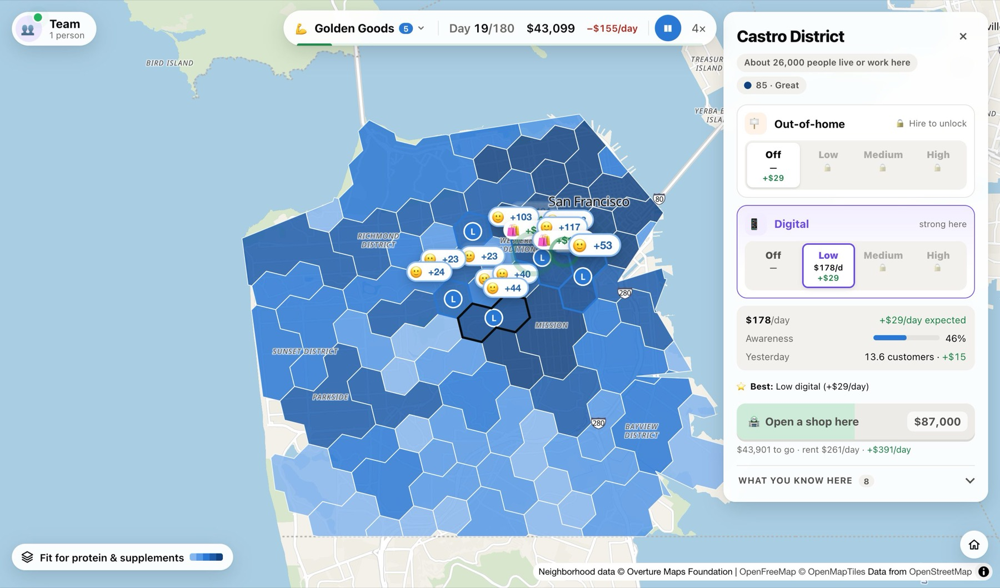

# Advertising Hero

**A browser game that teaches you how advertising works by letting you grow a brand across the real neighborhoods of San Francisco.**

**[Play it](https://ad-empire-sf.onrender.com)**: free, no account.



## Why I made it

Advertising is easy to spend money on and hard to learn. You read about it, or you lose your own money finding out. I wanted people to learn it the way you learn a video game, and to do it on a real map, because the lessons are about places: go where your buyers are, not where the crowd is. Every clue in the game is something that really exists in San Francisco.

What you pick up by playing:
- A quiet neighborhood full of your buyers can beat an expensive, busy one.
- Billboards take weeks to work and linger; digital works in days and stops when you stop.
- Doubling the spend doesn't double the customers.
- Advertising everywhere is the fastest way to go broke.

## How it plays

1. **Name your brand and pick one of 20 products.** You owe the bank $500,000 and have $50,000 left.
2. **Read the map.** Color it by gyms, offices, pharmacies or any of 103 kinds of places to work out where your buyers are.
3. **Buy ads** neighborhood by neighborhood, in two channels: digital and out-of-home (billboards, posters).
4. **Grow.** Hire buyers to unlock stronger ads, or open shops.
5. **Pay the bank back by day 180.** The day you do is your score.

Easy shows what matters and suggests moves. Hard gives you a clue or two, and you learn the rest by advertising.

## What's real

One release of [Overture Maps](https://overturemaps.org/): about 64,000 places, 160,000 buildings and 7,700 transit stops, turned once into 76 neighborhoods in about 440 KB.

| In the game | From Overture |
|---|---|
| How many people live or work there | building footprints × floors |
| Your buyers, the stores that carry you, your competitors | counts of each kind of place |
| Busyness and ad prices | transit stops and how dense the places are |
| The names in "What you know here" | real businesses |
| Neighborhoods | city boundary, neighborhood names, parks |

**What isn't real:** Overture has no sales, rent or foot-traffic data, so prices and purchase rates are invented, and which places matter to which product is my design. That's also why this is a game and not a planning tool: a tool would have to present invented revenue as a forecast.

## Trade-offs and cuts

- **Less data than the map has.** 103 of about 260 place types. With everything in, finding your buyers was a search problem, not a game.
- **Only San Francisco.** One city let me balance the game properly. The scripts could be adapted to another city, but its neighborhood names, parks and balance would need work.
- **Only two ad formats.** Real advertising has many more. I kept it to digital and out-of-home to keep the game simple and fun.
- **Neighborhood borders are approximate.** Overture outlines few of SF's neighborhoods, so they're built from hexagons around its neighborhood names.

Next: more cities, and people and transit as map colors. More on every decision, with the numbers: [DESIGN.md](DESIGN.md).

## Run it

Needs Node.js.

```bash
npm install
npm run dev       # http://localhost:5174
npm test          # 173 tests of the game rules
npm run report    # bots play every product, to check the balance
```

Rebuild the map data (optional, Python 3.9+):

```bash
python3 -m venv .venv && source .venv/bin/activate
pip install -r requirements.txt
python scripts/extract.py        # downloads San Francisco from Overture (1-2 min)
python scripts/build_zones.py    # writes public/data/
```

Built with Vite, React, TypeScript and MapLibre GL. Map data © [Overture Maps Foundation](https://overturemaps.org/), © OpenStreetMap contributors, release `2026-11-18.0`.
